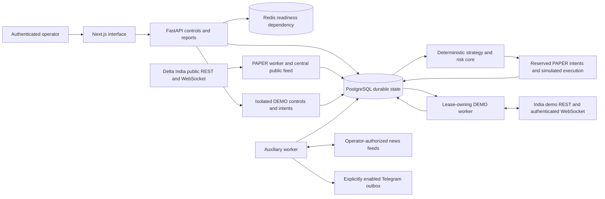

# Architecture

TradeBot Pro separates historical research, internal PAPER execution and a gated
Delta Exchange India DEMO executor. The target remains [requirements.md](requirements.md).
Implemented code, real public connectivity and private-account acceptance are
separate kinds of evidence; [PROGRESS.md](../PROGRESS.md) records the current results.
Production order submission and live activation are unavailable.

## System boundary

The browser contains no exchange credentials or execution engine. Closing it
leaves the worker processes running. API writes persist reviewed controls and
intents; a worker owns exchange order submission. A started DEMO process with no
connected account performs no private requests. Telegram transport remains
inactive until secure configuration, stored allowlists and the local delivery
flag enable it.

## Components

| Component | Responsibility and boundary |
| --- | --- |
| `apps/web` | Authenticated controls, charts, research, PAPER/DEMO account views and explicit degraded or missing evidence. The backend proxy runs on the server. |
| `services/api/tradebot` | Versioned API, SQL persistence, MFA/RBAC, audit, evidence, research and account controls. |
| `packages/core/tradebot_core` | Decimal contract economics, causal indicators and rules, multi-timeframe context, regime/filter checks, central risk and historical simulation. No credentials or exchange writes. |
| `packages/delta/tradebot_delta` | Exact India endpoints, public transport, demo HMAC signing, throttling and uncertain-order handling. Production private execution is absent. |
| PAPER worker | Public REST recovery, a centrally leased public stream task, approved strategy evaluation, reservations, protection replay and durable heartbeat. |
| DEMO worker | Separate account lease, authenticated stream recovery, exact-version demo runs, authoritative reconciliation, intent submission and protective-order management. |
| Auxiliary worker | Completed-period reports, authorized news polling, Telegram outbox and allowlisted commands, with independent transactions. Trading protection does not wait for it. |
| PostgreSQL | Account authority, leases, intents/events/fills, versions, immutable research inputs and reporting records. |
| Redis | Configured readiness/cache dependency. Trading ownership and financial durability use PostgreSQL locks and leases. |

The API and workers share reviewable Python modules and a database deployment.
Separate processes isolate transport, protection and auxiliary scheduling without
requiring distributed transactions between microservices.

## Market and research data

Public ingestion validates closed-candle timestamps, OHLC relationships and
continuity. The mutable `candles` table is an operational cache. Attributed
`candle_revisions` preserve observations; an immutable historical dataset pins
ordered revisions and a content hash. A later correction cannot silently change
that pinned dataset through the application's ORM/API. Gaps, feed sequences,
freshness and reconnect recovery remain visible in their own records.

Backtests and advanced research refer to an exact strategy version and explicit
data identity. Walk-forward, stability, parameter, Monte Carlo and portfolio
results are research outputs, separate from active account cash. Imported research
material creates reviewable candidates; it cannot authorize exchange trading.
Simulated performance does not promote a strategy to live.

## Execution isolation

| Environment | Data and account state | Executor and gate |
| --- | --- | --- |
| BACKTEST | Explicit historical inputs and stored research results | Internal historical simulator; no exchange trading credentials. |
| PAPER | Production public observations, virtual account, PAPER orders/fills and financing movements | Internal simulator; account lease, central risk, approved version and healthy data required. |
| DEMO | Separate demo products, candles, account, orders, fills, cash movements and strategy-run tables | Demo-only adapter; secure demo credentials, local write authorization, MFA-confirmed enablement and verified contract economics required. |
| LIVE | Production public observations may be researched | Production private executor and activation remain unavailable. |

Demo state never reuses PAPER positions, fill identifiers, account cash or the
production product-ID namespace. Environment separation is explicit in tables
and adapter destinations. A mode variable cannot turn a PAPER process into a
production executor. Credential rotation changes the connected-account
fingerprint and requires account review before further demo use.

A `DEMO` approval records permission to execute an exact demo version. It does
not certify successful credentialed integration and is distinct from the
`DEMO_APPROVED` acceptance gate. Offline mocks and a strategy-start response
cannot satisfy that gate. Current private acceptance remains pending where no
secure credentials or real order evidence are available.

## Ownership, transactions and recovery

PAPER uses exclusive strategy/position ownership per symbol, account-row
serialization and stable signal identities. Pending entries reserve risk,
margin and exposure. Every tranche rechecks both its new fill and all remaining
reservations; stopping an entry preserves protection on filled quantity. Position
policy and economic snapshots retain the entry version. Protection replays from
a durable candle cursor and rejects uncertain continuity.

DEMO treats exchange snapshots and unique exchange fill/transaction identities
as authoritative. Manual/external exposure is visible and blocks new entries
instead of being silently adopted. Unknown submission outcomes retain the
original client ID and never trigger blind resubmission. Reconnects require
REST reconciliation before entry readiness. Leases are checked again after
network I/O; a heartbeat alone cannot establish ownership.

The security boundary includes opaque sessions, CSRF, operator/viewer roles,
TOTP, recent sensitive authentication, local encrypted credentials and audit.
Review evidence is exact-version and append-only through the API. See
[database.md](database.md), [risk-and-state-machines.md](risk-and-state-machines.md)
and [security.md](security.md) for invariants and deployment limits.

HTTPS reverse-proxy and monitoring configurations, encrypted backup tooling and
restore checks are provided. Their presence does not demonstrate a deployed VPS,
independent security review, working external notification destination or
credentialed private-exchange acceptance. Those checks and explicit limited-live
authorization remain separate operational gates.
