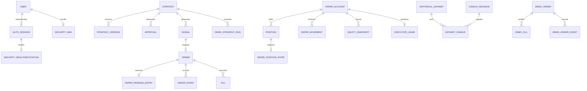

# Database model and persistence

PostgreSQL is the deployment database. SQLAlchemy models, the model registry and
Alembic migrations define the schema. SQLite isolates offline tests and does not
establish PostgreSQL locking or concurrency guarantees. Financial state uses
`NUMERIC`/`Decimal`; currencies and contract multipliers remain explicit.

## Relationships

PAPER and DEMO tables are separate namespaces, including instruments and candles.
The initial implementation supports one configured PAPER account and one
configured DEMO account; table presence does not imply general multi-account or
cross-asset margin support.

## Implemented record groups

| Group | Tables and purpose |
| --- | --- |
| Identity/security | `users`, `auth_sessions`, `login_attempts`, `security_mfa`, `security_reauthentication`, `security_attempts`, `security_readiness_evidence`. Roles are user fields, not a separate granular-role table. |
| Strategy/research | `strategies`, `strategy_versions`, `approvals`, `signals`, `backtests`, `research_runs`, `research_documents`, `research_candidates`. Backtest trades and many research metrics are result JSON. |
| PAPER execution | `paper_accounts`, `risk_config`, `orders`, `order_events`, `fills`, `positions`, `equity_snapshots`, `executor_leases`, `paper_pending_entries`, `paper_position_state`, `paper_funding_events`, `paper_movements`, `paper_strategy_risk_state`. |
| Public data/provenance | `instruments`, `candles`, `candle_revisions`, `historical_datasets`, `dataset_candles`, `market_data_gaps`, `market_feed_states`, `market_stream_leases`. |
| DEMO execution | `demo_accounts`, `demo_products`, `demo_candles`, `demo_orders`, `demo_order_events`, `demo_fills`, `demo_positions`, `demo_equity_snapshots`, `demo_strategy_runs`, `demo_protection_orders`, `demo_cash_movements`. |
| News/reports/notifications | `news_sources`, `news_events`, `news_blackout_rules`, `news_source_observations`, `performance_reports`, `notifications`, `telegram_settings`, `telegram_outbox`. |
| Operations | `audit`, `worker_heartbeats`, `telemetry_state`, plus the execution and stream leases above. |

Exact columns and constraints are available through
[model_registry.py](../services/api/tradebot/model_registry.py) and its imported
model modules. Dedicated normalized tables for every target entity, database-wide
append-only privileges and a general multi-asset portfolio ledger are not implied.

## Persistence invariants

| Record | Invariant |
| --- | --- |
| Money | Decimal arithmetic and explicit settlement asset. Serialized decimal strings avoid frontend precision loss. |
| Time | UTC economic execution times, observation/ingestion times and audit timestamps. Presentation may use Asia/Calcutta. A replayed modeled fill retains its assigned historical execution time. |
| Operational candles | Unique symbol/timeframe/open-time identity within the PAPER/public cache; DEMO uses a separate cache. Only validated closed bars are tradable. |
| Revisions/datasets | Attributed content hashes, ordered revision membership, recorded missing ranges and warnings. ORM update/delete guards prevent mutation of pinned research input. These are application protections, not a claim that a privileged raw-SQL administrator cannot alter data. |
| Strategy versions | Stored configuration snapshots; approvals, runs and research identify the exact version. Position policy/economic snapshots survive pauses and retain original execution policy. |
| PAPER fills | Multiple fills per order are supported. Deterministic entry-tranche identities prevent duplicate execution after restart. Quantity and fee totals must reconcile with ownership and remaining protection. |
| PAPER reservations | Pending margin/risk/exposure remains committed until filling, cancellation, expiry or rejection. Tranche checks include the still-unfilled remainder. |
| PAPER movements | Reset flows, attributed financing and liquidation charges remain distinct from fill P&L. Resets preserve history, require no running exposure and adjust period-flow accounting. |
| Strategy risk observations | Exact-version allocated baseline, P&L baseline, current/peak equity, observation times and ledger validity. Peaks come from persisted observations after valid protection handling; missing historical peaks are never inferred from shared account snapshots. |
| DEMO fills/cash | Unique exchange identities and asset-native amounts reconcile to authoritative snapshots. Unknown orders and unexplained external exposure block entries. A local snapshot cannot silently overwrite exchange evidence. |
| Events/audit | API transitions and reviewed actions append evidence. A cancel cannot erase an earlier fill. Audit actors are strings, not user foreign keys. |
| Credentials | Exchange values are outside these tables, in secure runtime environment or the encrypted local vault. Encrypted MFA secrets are stored in `security_mfa`; their decryption key is retained separately. |

Historical backtests never mutate active account cash. Research run parameters and
results retain data hashes and version identities. Performance reports preserve
period, account/currency and payload evidence; unavailable measurements remain
explicitly unavailable instead of being fabricated.

## Serialization and migrations

Account rows and durable execution leases serialize financial changes and worker
ownership. Network I/O occurs outside the PAPER executor transaction, followed by
an ownership recheck. Separate DEMO order/event/fill constraints and account lease
protect its coordinator. PostgreSQL integration and concurrent-owner tests are
required; Redis freshness is not financial authority.

Run `alembic -c services/api/alembic.ini upgrade head` before service startup using
the deployment environment. The repository's migration chain adds durable
protection cursors, expanded PAPER/DEMO/research/security/data records and the
asset-native DEMO cash ledger. Do not replace upgrades with destructive
`create_all`, drop/reset or guessed migration revision updates.

## Backup and recovery

Take a PostgreSQL custom-format backup before deployment changes. Restore it into
an isolated database and verify migration revision, critical records, constraints
and financial totals. Local restore tooling preserves a populated database and
only restores a genuinely empty snapshot destination automatically.

Encrypted backup and explicit SFTP tooling are provided. Offsite destinations,
host-key trust, retention and actual scheduled delivery must be configured and
verified on the deployed host. Database dumps contain encrypted MFA records;
restore also needs the separately secured vault key ring. Exchange credential
vault files and encryption keys are not automatically included in a database
dump. A development SQLite file must not become an exchange trading database.
