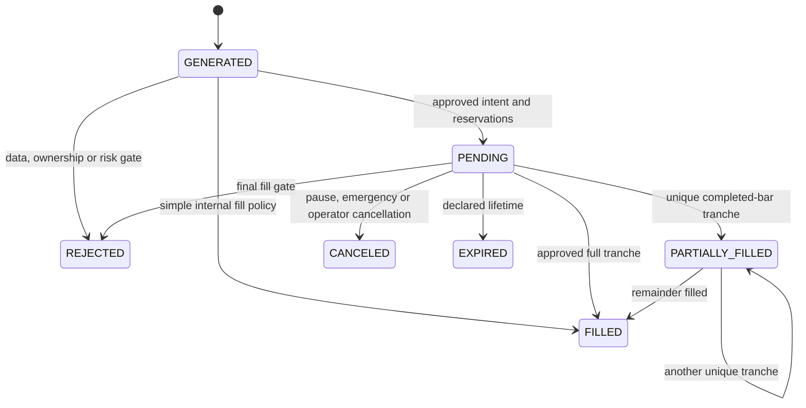
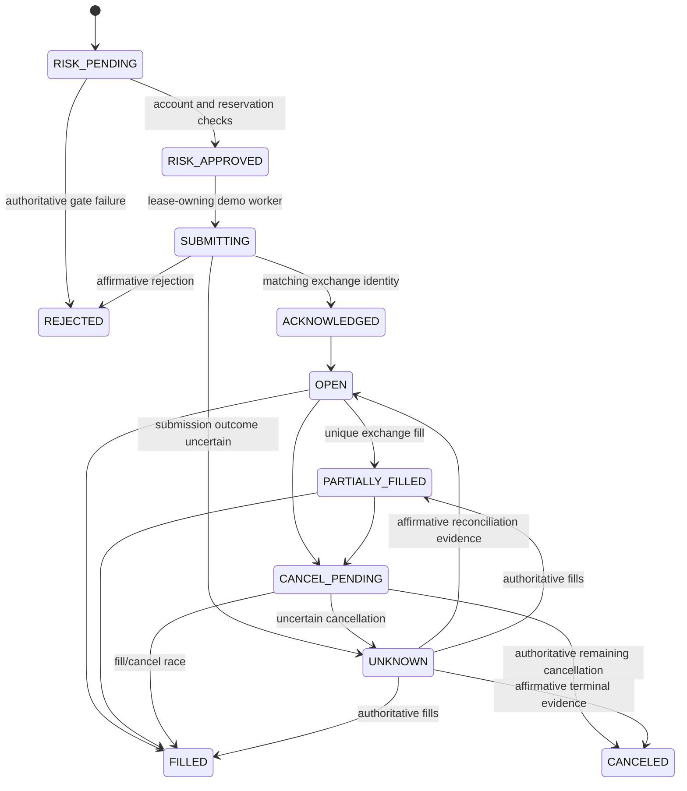

# Risk and state machines

Strategies emit signals. Central risk, durable account coordination and the
appropriate worker decide whether a signal acquires exposure. Browser controls
cannot bypass these checks. PAPER simulator behavior and implemented DEMO
coordination are distinct from real credentialed exchange acceptance.

## Pre-trade authority

Sizing uses Decimal contract economics, explicit settlement currency,
conservative tick/quantity rounding and paid/adverse entry/exit costs. Unsupported
inverse or quanto economics, unverified execution metadata and missing conversion
evidence reject sizing. Publicly observed linear economics may support a clearly
labeled internal PAPER model; those minimum-size or margin assumptions cannot
certify a DEMO order.

Risk bounds cover trade risk, combined position and pending risk, gross/net
exposure, available margin, leverage, open/pending counts, daily/weekly losses,
drawdown, spread/slippage and stale or uncertain state. Strategy allocation,
cooldown, daily trade/loss limits, consecutive losses, strategy drawdown, position
counts, declared liquidation distance and allowed environments add narrower gates.
Strategy filters use causal higher-timeframe, regime/session, news and explicit
funding evidence. A required source that becomes stale blocks the final fill.
Risk boundaries currently use UTC day/week accounting; scheduled reports use
Asia/Calcutta presentation periods.

PAPER sizing distinguishes actual used margin from capital reserved for a
strategy. Unallocated cash is not treated as already used account margin.
Risk presets are editable research examples, not universal safe limits. INR
planning capital is separate from a USD/USDT virtual settlement balance; a rate
must be explicit before currency conversion. A profit target does not determine
position size or relax a risk limit.

## Optional strategy and exposure controls

Consecutive losses use completed exact-version positions, their entry/exit fees
and attributed financing/liquidation movements. A gross winning trade can be a
net loss. Invalid quantity, ownership, currency or realized-P&L evidence blocks
these controls instead of manufacturing a performance history. A nonlosing
closed trade ends the loss streak.

Strategy drawdown uses an allocated baseline observed before the first entry for
that immutable version, plus actual attributed realized/unrealized P&L and costs.
Persisted peaks update after each surviving protective candle and financial
snapshot; a bar that stopped out earlier cannot invent a later closing peak.
The record states when observation began. Configuring drawdown on prior positions
without that baseline fails closed; shared account snapshots do not reconstruct
an unseen strategy peak. Virtual balance RESET flows do not count as strategy
profit. An existing partial position counts once for strategy position limits.

Minimum liquidation distance requires an explicit declared isolated maintenance
model and evaluates prospective combined partial-fill economics. It is a PAPER
model gate, not exchange margin certification. Optional DEMO strategy controls
whose isolated context is unsupported are refused rather than reading PAPER
records.

Account correlation controls use explicitly configured symbol groups and a gross
notional cap relative to account equity. Existing positions, pending exposure and
the proposed tranche count toward the relevant group. The model does not infer
correlation coefficients or promise diversification from historical estimates.

The PAPER worker automatically pauses an approved running strategy when its
consecutive-loss or drawdown limit is breached, or the required strategy ledger
or baseline cannot be evaluated safely. It records an audit event and warning,
cancels the unfilled entry remainder and retains existing protective orders.
Position-count limits block additional entries without suspending protection.

Immediate and pending PAPER entry checks require a fresh bounded clock
observation from public verified HTTPS. Missing, stale or unsafe observations
block new exposure. HTTPS Date may originate at an intermediary, so this check
does not certify exchange signing time or replace operating-system NTP.
Observations are ordered under a database row lock using their monotonic
timestamp, and isolated by Linux boot/time-namespace identity. On standard
procfs with both time-namespace APIs absent, boot identity supplies the shared
domain. Deployments must expose standard procfs rather than selectively hide
those interfaces. Permission and inconsistent-provenance failures remain
unhealthy; restored evidence from another boot cannot establish clock health.

## PAPER signal and entry lifecycle

A stable signal identity pins strategy/version, closed-candle time and side.
Duplicate processing returns the existing decision and cannot add exposure.
Canceled partial entries retain their filled position and protection; a signal
may retain `PARTIALLY_FILLED` to describe that historical result while the entry
order is `CANCELED`.

An advanced intent reserves its whole approved margin/risk. Each tranche checks
its new exposure together with existing positions, other pending reservations
and its own remaining quantity. Execution is transactional under the account
lock. A strategy's existing partial position counts as the same daily trade;
its margin, P&L and financing still count toward allocation and loss limits.

Limit penetration and optional completed-candle volume caps are declared
simulator assumptions, not observed exchange liquidity. Assigned entry time is
the bar close. Only that close can trigger protection on the entry bar; earlier
highs/lows are pre-entry history. Later protection uses a durable cursor. Missing
continuity blocks additional exposure, while a worker restart never invents
historical entry opportunities. See
[persisted-paper-execution.md](persisted-paper-execution.md).

## DEMO order lifecycle

The coordinator persists exchange intents and events using these state names:

The pure core transition model has its own supported subset beginning with
`CREATED` and uses `CANCEL_PENDING`/`CANCELED`. Concrete coordinator/API states
above include its persisted risk and open steps. Neither `CANCEL_REQUESTED` nor
`CANCELLED` is an application status spelling. Events and fill identities are
idempotent; cancellation never reverses a confirmed fill.

## Unknown outcomes and authoritative recovery

A timeout after POST means uncertainty, not exchange rejection. Keep `UNKNOWN`
and the original client ID, preserve reservations, block additional exposure
and recover order/fill/position evidence. A lookup failure or restart never
licenses a replacement POST. Client IDs obey the documented maximum length.

The DEMO worker needs its account lease, a connected authenticated stream,
recent reconciled snapshots, exact approved version, reviewed economics, local
write authorization and enabled account entries. Stream loss, sequence gaps or
manual/external account changes request REST reconciliation. Exchange snapshots
remain authoritative; unexplained exposure is visible and blocks entries instead
of being silently adopted or overwritten. Wallet movements retain exchange
transaction identity and asset-native amounts, including funding evidence.

## Position protection and emergency controls

PAPER brackets are internal simulator records. Multiple targets reduce the
actual remaining quantity and refresh matching stop/target records. Completed
bar trailing updates take effect on the next bar; cost-inclusive break-even
covers entry and modeled exit fees, financing and adverse execution. Financing
posts once per explicit position/event pair, with old financing allocated across
partial exits and new events applied to remaining quantity.

Optional isolated liquidation is an internal linear model. Entry margin must
cover configured maintenance and liquidation fees. A gap beyond liquidation
wins over an unavailable stop; otherwise the nearer loss-side threshold wins.
New end-bar financing cannot retroactively change an earlier low/high. Historical
exits retain their assigned time and never charge later financing. These rules
are not certification of Delta maintenance tiers or liquidation behavior.

DEMO protection requires matching authoritative reduce-only stop and target
orders, not merely a submitted request. Missing or uncertain protection marks
exposure unprotected, blocks further entries, retains evidence and alerts. Safe
recovery and managed reduction remain bounded by actual position evidence;
external positions are not flattened as if owned by the bot.

Emergency actions distinguish blocking new entries, canceling pending entries,
pausing strategy runs and explicitly closing/flattening managed positions.
Blocking entries does not claim positions are closed. PAPER protection remains
active while its strategy is paused or stopped. DEMO cancellation and closure
remain pending until exchange evidence confirms them. Database failure, stale
prices, ownership conflict, uncertain orders or bad protection fail closed for
new exposure. A restart alone does not clear the underlying incident.

## Promotion evidence

PAPER approval pins a validated version and completed backtest. A `DEMO` approval
permits that exact version to run in the gated demo account; it is not successful
private acceptance evidence. `DEMO_APPROVED` is a separate live-readiness gate.
MFA-protected append-only review records identify version, category, outcome,
evidence URI and digest. A recorded review digest is an operator assertion,
not independent verification by downloading the link.

Profitability cannot create live authorization. Production activation remains
unavailable. Credentialed demo lifecycle/protection acceptance, external security
review, deployment recovery evidence and explicit limited-live authorization
must be established separately; see [PROGRESS.md](../PROGRESS.md).
